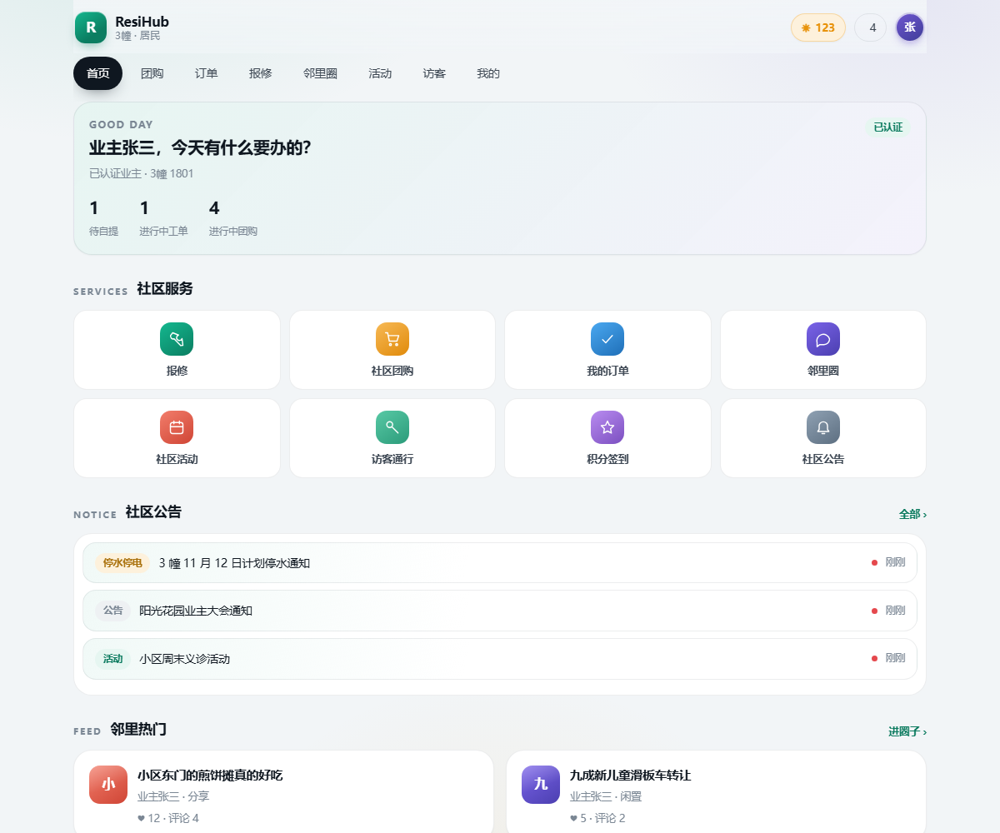
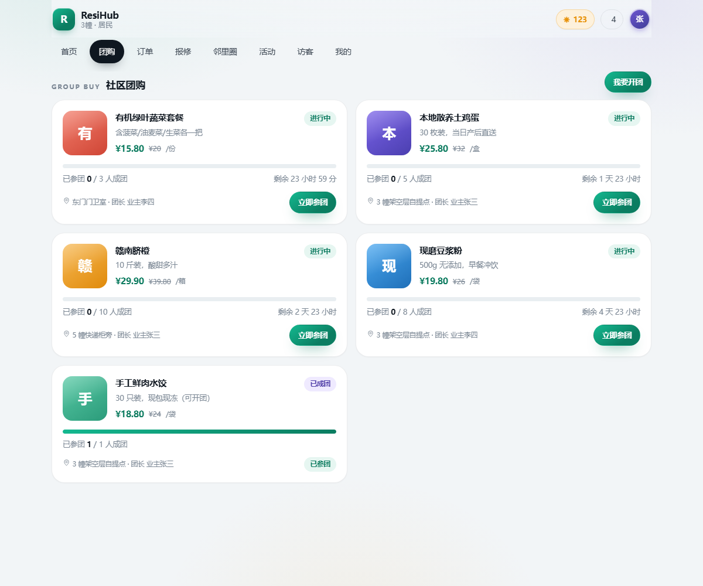
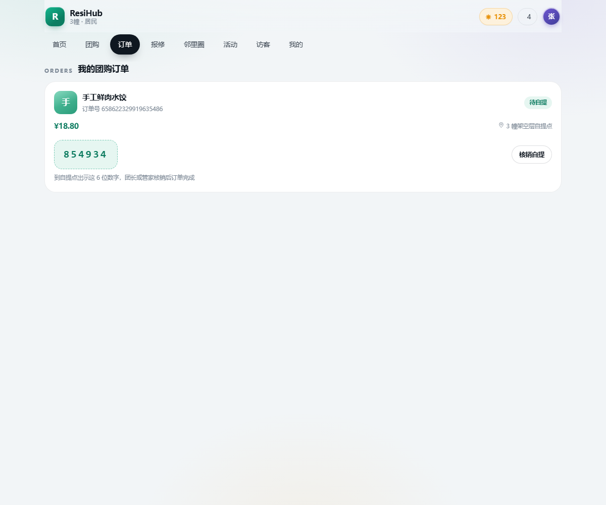
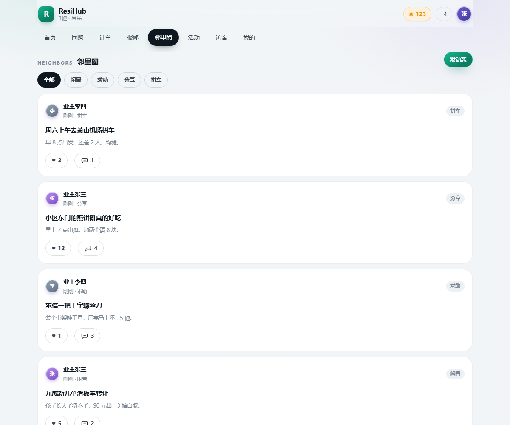
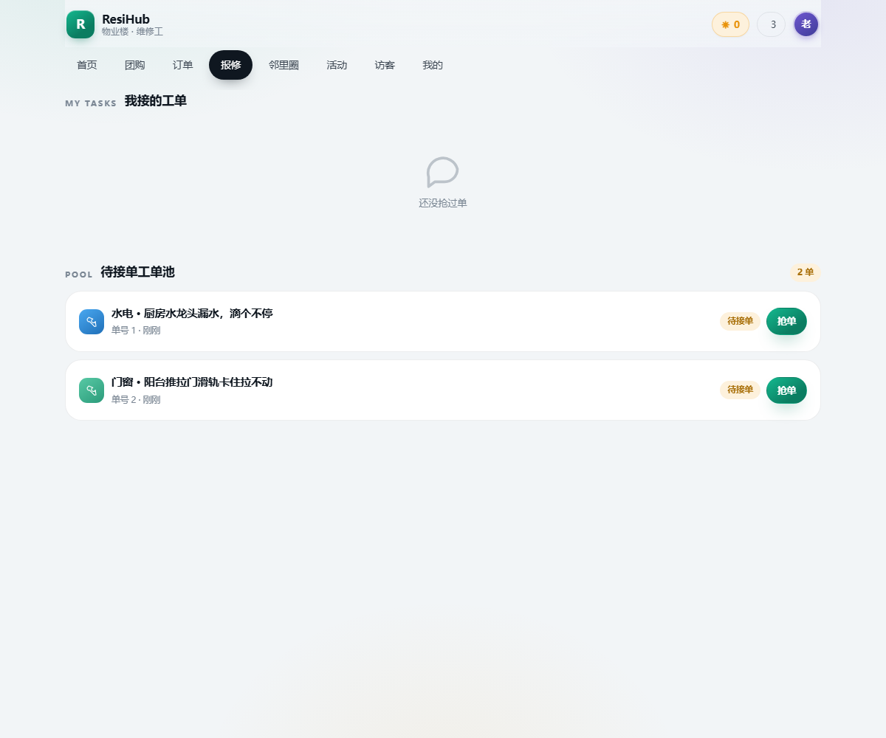
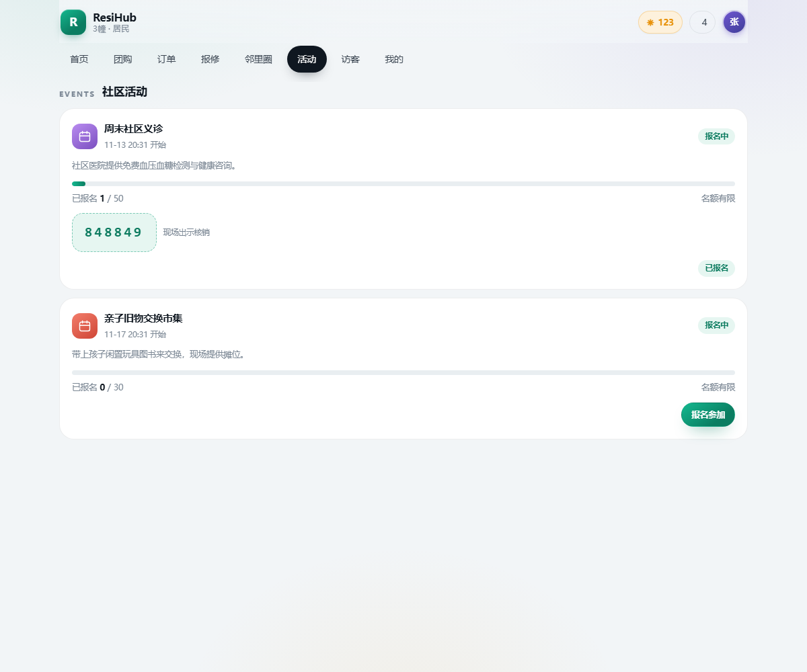
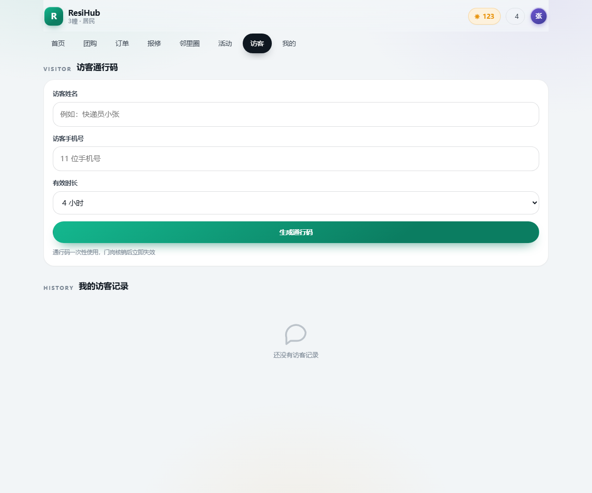
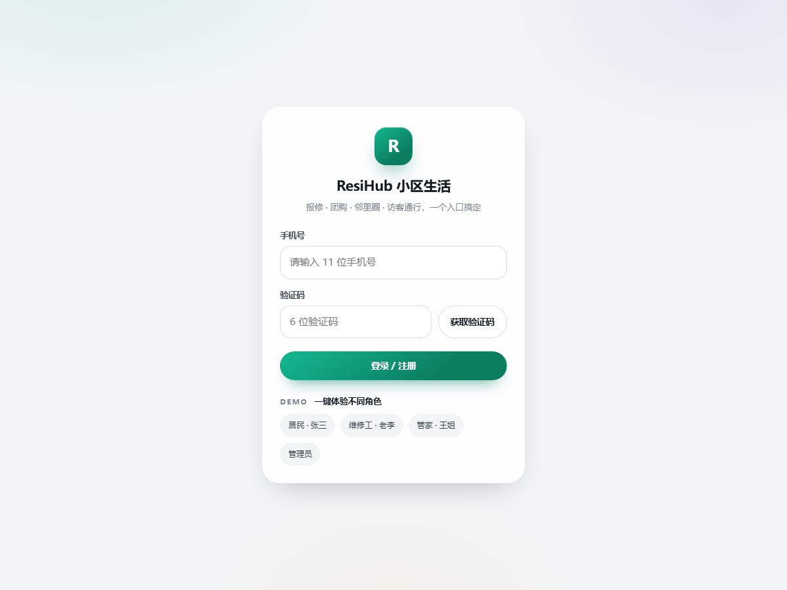
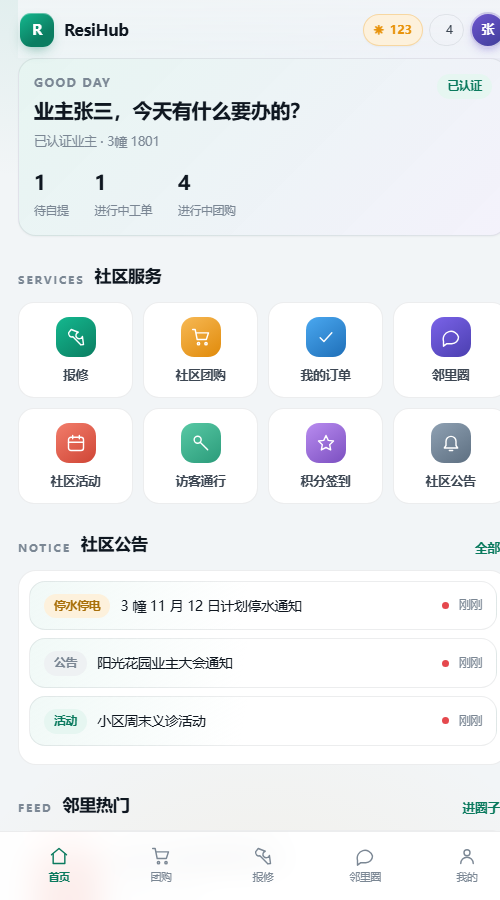

# ResiHub · 小区居民智能生活服务平台

面向住宅小区的综合服务平台后端：**物业履约**（报修工单、公告、访客通行、业主认证）＋**社区交易**（社区团购从开团到自提核销）＋**邻里内容**（动态、点赞、评论、活动报名、积分）。

> 单仓库、单体 Spring Boot，重点在**并发正确性**与**事件驱动**：名额不超卖、一人一单、订单异步落库不丢不重、没人接的单子会自动升级。

---

## 技术栈

| 层 | 选型 |
|---|---|
| 框架 | Spring Boot 2.3.12 / Spring MVC / MyBatis-Plus 3.4.3 |
| 存储 | MySQL 8（`resihub` 库） / Redis 8（业务用 db 1） |
| 并发与事件 | Lua 脚本、Redis Stream 消费组、Redisson 分布式锁、Redis ZSet 延迟队列、Spring `@Scheduled` |
| 其他 | Hutool、JdbcTemplate（积分流水）、JDK 21 运行（`--release 8` 编译） |

## 架构

```
                       ┌─────────────────────────────┐
   浏览器 / 小程序  ──▶ │  Nginx（静态页 + /api 反代）│
                       └──────────────┬──────────────┘
                                      │
                       ┌──────────────▼──────────────────────────────┐
                       │ Spring Boot (8082)                          │
                       │                                             │
                       │  RefreshTokenInterceptor  token 续期/会话同步 │
                       │  LoginInterceptor        登录校验            │
                       │  RoleInterceptor         @RequireRole RBAC  │
                       │                                             │
                       │  User / Community / Notice / Notification   │
                       │  Product / GroupBuy / Order  ← 团购交易线    │
                       │  WorkOrder                   ← 报修履约线    │
                       │  Post / Activity / VisitPass / Points       │
                       └───┬───────────────┬───────────────┬─────────┘
                           │               │               │
                  ┌────────▼──────┐ ┌──────▼──────┐ ┌──────▼─────────────┐
                  │ MySQL         │ │ Redis       │ │ 后台线程 / 定时任务 │
                  │ 业务主数据     │ │ 缓存/名额/码 │ │ Stream 消费者       │
                  └───────────────┘ └─────────────┘ │ 团购到点判定        │
                                                    │ 工单超时升级        │
                                                    └────────────────────┘
```

## 功能矩阵

| 角色 | 能做什么 |
|---|---|
| **居民** | 验证码登录 → 选小区+楼栋房号 → 业主认证；看公告（含楼栋定向、未读红点）；提报修单/看进度/确认评价；参团、开团、看订单、出示自提码；发邻里动态/点赞/评论；报名社区活动拿核销码；生成访客通行码；签到攒积分 |
| **维修工** | 工单池（本小区待接单）→ 抢单 → 上传完工 → 我的工单 |
| **管家** | 业主认证审核、发公告、工单看板（含超时升级）、创建活动并核销、团购/访客码核销 |
| **管理员** | 与管家同权（`role=3`），保留小区与用户管理扩展位 |

接口清单见文末。

## 六个关键技术点

### 1. 参团：Lua 原子扣名额 + Stream 异步落库

请求线程只做「够不够格」，落库交给消费组：

```lua
-- lua/join_group.lua
if tonumber(stock) <= 0 then return 1 end                 -- 名额不足
if redis.call('sismember', usersKey, userId) == 1 then return 2 end  -- 一人一单
redis.call('decr', stockKey)
redis.call('sadd', usersKey, userId)
redis.call('xadd', streamKey, '*', 'orderNo', ..., 'groupId', ...)
```

DB 侧再兜两层：`product.stock = stock - 1 where stock > 0`（条件扣减防超卖）、`uk(user_id, group_buy_id)` 唯一索引（并发下重复下单直接打回）。

### 2. 消费端：不丢、不重、不阻塞

- **XACK 用真实 stream 名**（不是随便一个 key），否则 PEL 永远不清理、异常时整段重放
- 处理失败 **不 ack**，留在 pending 里重试；`orderNo` 唯一键保证重放幂等
- `XREADGROUP ... BLOCK` 是阻塞命令，**独享一条连接**，否则会把同一连接上的普通命令一起阻塞（实测 200 并发下 P50 从 20ms 恶化到 1200ms）

### 3. 缓存：穿透 + 击穿两套方案并存

`CacheClient` 同时提供空值缓存（穿透）与逻辑过期 + 异步重建（击穿），重建锁用 `UUID + Lua 比对删除`，避免误删他人锁。商品详情走逻辑过期：过期了先返旧值，后台线程池重建。

### 4. 抢单：Redisson 锁 + 状态条件更新双保险

```java
lock.tryLock(2, 10, SECONDS);                         // 第一道：分布式锁
update().set("status", 1).set("assignee_id", me)
        .eq("id", id).eq("status", 0).update();       // 第二道：CAS
```
锁只是为了减少无效竞争，**正确性靠 CAS**：两个维修工同时抢，只有一个 `where status=0` 能命中。

### 5. 超时升级：ZSet 延迟队列

提报修单时 `ZADD work:timeout <到点时间戳> <id>`；定时任务 `rangeByScore 0..now` 取出到期单，条件更新 `0→4` 并通知管家。接单成功即 `ZREM` 出队。

### 6. 一次性凭证：Lua 核销

访客码创建时写 `visit:pass:{code}="0"` 带 TTL；核销用脚本一次原子完成「存在性 → 是否已用 → 标记已用（`KEEPTTL`）」，DB 侧再 `where used=0` 兜一层。

## 压测结果（本机实测，非估算）

环境：应用 + MySQL + Redis + 压测客户端同机（16 核 Windows），客户端 `java.net.http`，所有线程预热后同时开火。

| 场景 | 并发 | 名额 | 成功 | 失败分布 | 库内订单 | 库存 | P50 / P95 / P99 | 吞吐 |
|---|---|---|---|---|---|---|---|---|
| **不同用户抢名额** | 200 | 10 | **10** | 名额不足 190，其他 0 | **10** | 0 | 246 / 256 / 257 ms | 176 req/s |
| **同一用户重复抢** | 50 | 50 | **1** | 重复参团 49 | **1** | 49 | 67 / 72 / 73 ms | 151 req/s |

结论：**零超卖、零重复下单、零消息丢失**（成功数 == 库内订单数 == 库存扣减数）。
延迟包含客户端排队与同机资源竞争；单请求基线（另测）`/community/list` ≈ 3ms。

复现：

```powershell
powershell -NoProfile -ExecutionPolicy Bypass -File scripts/loadtest/prepare.ps1   # 造 200 个业主 + 10 名额的团
java -Djdk.httpclient.connectionPoolSize=500 scripts/loadtest/LoadTest.java http://127.0.0.1:8082 <groupId> scripts/loadtest/out/tokens.txt 10 200
java -Djdk.httpclient.connectionPoolSize=500 scripts/loadtest/LoadTest.java http://127.0.0.1:8082 <groupId> scripts/loadtest/out/tokens.txt 50 50 single
```

## 冒烟测试：128 项全绿

四个可重复执行的脚本，覆盖全部功能点（含权限、边界、幂等、状态机）：

| 脚本 | 覆盖 | 断言数 |
|---|---|---|
| `scripts/smoke/smoke-p0.ps1` | 登录、小区、业主认证审核、RBAC、公告楼栋定向/已读/未读、站内消息 | 29 |
| `scripts/smoke/smoke-p1.ps1` | 开团、参团、一人一单、成团、核销、流团退款与库存回滚 | 33 |
| `scripts/smoke/smoke-p2.ps1` | 提报修、抢单竞争、完工、评价+积分、超时升级 | 29 |
| `scripts/smoke/smoke-p3.ps1` | 邻里圈发帖/点赞/评论、活动名额限流+核销、访客码一次性、签到 Bitmap | 37 |

```powershell
powershell -NoProfile -ExecutionPolicy Bypass -File scripts/reset.ps1          # 回到干净种子数据
powershell -NoProfile -ExecutionPolicy Bypass -File scripts/smoke/smoke-p1.ps1
```

## 快速开始

```powershell
# 1. 中间件：MySQL 8（root/990829）+ Redis（6380，db1）
# 2. 建库导数据
mysql -uroot -p < src/main/resources/db/init.sql
# 3. 打包启动
mvn -DskipTests package
java -jar target/resihub-1.0.0.jar        # http://127.0.0.1:8082
```

种子账号（验证码登录，验证码打印在应用日志里）：

| 手机号 | 角色 |
|---|---|
| 13900000001 | 管理员 |
| 13900000002 | 管家 |
| 13900000003 | 维修工 |
| 13900000004 / 05 | 居民（小区 1） |
| 13900000006 | 居民（小区 2，用于验证数据隔离） |

## Docker 部署（一条命令起全套）

```powershell
cd D:\ResiHub
docker compose up -d --build        # MySQL 8 + Redis 7 + 应用（前端由应用自己托管）
docker compose logs -f app          # 看到 "Tomcat started on port(s): 8082" 即就绪
# 浏览器打开 http://127.0.0.1:8082/
```

- 多阶段构建：`maven:3.9-eclipse-temurin-21` 编译 → `eclipse-temurin:21-jre` 运行，产物 `resihub:1.0.0`
- 首次启动自动执行 `src/main/resources/db/init.sql`（建表 + 种子数据），数据落在 `mysql-data` / `redis-data` 卷
- 容器内按服务名互访（`mysql:3306` / `redis:6379`），用 `SPRING_*` 环境变量覆盖配置，**不需要改 jar 里的 application.yaml**
- 默认不对外暴露 MySQL/Redis 端口，避免和本机已有的 3306 / 6380 冲突；要用本地客户端连就打开 compose 里注释掉的 `3307:3306` / `6381:6379`

```powershell
docker compose down        # 停止，保留数据
docker compose down -v     # 停止并清空数据卷（下次启动重跑 init.sql）
```

> 注意：`scripts/smoke/*.ps1` 是按**直连本机** MySQL(3306) / Redis(6380) 写的，容器化后要么打开端口映射并改脚本端口，要么用浏览器人工点验。

## 这版实现里踩到并修掉的坑

1. **XACK 用错 key** → PEL 永不清理，异常触发 pending 重放；改为真实 stream 名
2. **活动时间没校验** → 已结束/未开始的团仍能参；补齐 `status + deadline` 校验
3. **Redis 名额 key 缺失导致 Lua 崩**（`tonumber(false)` → nil 比较）→ 执行前 `SETNX` 兜底初始化
4. **会话与库不一致** → 提交认证/角色变更后 token 里还是旧小区和认证状态；加 `login:user_tokens:{userId}` 索引，变更后批量刷新该用户所有在线 token
5. **`Map<byte[], byte[]>.get(byte[])` 永远为 null**（`byte[]` 的 equals 是引用比较）→ Stream 消息被当成"字段缺失"直接 ack 掉，订单静默丢失；改为先解码成 `Map<String,String>`
6. **阻塞命令占满共享连接** → 消费端独立连接（见上文）

## 目录结构

```
src/main/java/com/resihub
├── config/       拦截器注册、MyBatis-Plus、Redisson、异常处理
├── controller/   user/community/notice/product/group-buy/order/work-order/post/activity/visit-pass/points
├── consumer/     Stream 订单消费者（独立连接）
├── entity/       User Community Notice Product GroupBuy Order WorkOrder Post Activity VisitPass PointsLog
├── mapper/       MyBatis-Plus BaseMapper
├── service/      接口 + impl
├── task/         团购到点判定、工单超时升级
└── utils/        拦截器、RBAC 注解、Redis 常量、ID 生成、缓存客户端
src/main/resources
├── lua/          join_group.lua（参团）、verify_pass.lua（一次性核销）
├── db/init.sql   全量建表 + 种子数据
└── application.yaml
scripts/
├── smoke/        p0~p3 冒烟（共 128 断言）
├── loadtest/     prepare.ps1 / LoadTest.java / Bench.java
└── reset.ps1     重置演示数据
```

## 接口清单（节选）

| 方法 | 路径 | 说明 |
|---|---|---|
| POST | `/user/code` `/user/login` | 验证码登录 |
| GET | `/user/me` | 我的信息（实时读库） |
| POST | `/user/apply` | 提交业主认证 |
| GET/POST | `/user/audit/list` `/user/audit/{id}/{pass}` | 认证审核（管家） |
| GET | `/community/list` `/community/{id}` | 小区（详情带缓存） |
| GET | `/notice/list` `/notice/{id}` `/notice/unread` | 公告 + 已读 |
| POST | `/notice` | 发公告（管家） |
| GET | `/product/list` `/product/{id}` | 团购商品 |
| POST | `/group-buy` `/group-buy/{id}/join` | 开团 / 参团 |
| GET | `/group-buy/list` `/group-buy/{id}` | 团列表/详情（含进度、是否已参团） |
| GET | `/order/my` `/order/{orderNo}` | 我的订单 |
| POST | `/order/{orderNo}/verify` | 自提核销（团长/管家） |
| POST | `/work-order` | 提报修单 |
| GET | `/work-order/pool` `/work-order/assigned` `/work-order/list` | 工单池/我接的单/看板 |
| POST | `/work-order/{id}/accept` `/finish` `/rate` | 抢单/完工/评价 |
| POST/GET | `/post` `/post/list` `/post/hot` `/post/like/{id}` `/post/{id}/comment` | 邻里圈 |
| GET/POST | `/activity/list` `/activity` `/activity/{id}/signup` `/activity/verify` | 社区活动 |
| POST | `/visit-pass` `/visit-pass/verify` | 访客通行码 |
| POST/GET | `/points/sign` `/points/sign/count` `/points/log` `/points` | 积分与签到 |
| GET | `/notification/list` `/notification/unread` | 站内消息 |

## 前端（随 jar 一起提供，零构建）

技术选择：**原生 JS + 手写 CSS，不引框架、不引 CDN、不用 Node 构建**——静态文件放在 `src/main/resources/static/`，Spring Boot 直接托管，`java -jar` 起来后访问 `http://127.0.0.1:8082/` 即可，同源无 CORS。

- 设计：单一主色（teal）+ 中性灰阶、卡片化、毛玻璃顶栏、底部 Tab（≤720px）、骨架屏、Toast、空状态、`prefers-reduced-motion` 适配
- 路由：hash 路由（`#/home`、`#/group` …），单文件 `js/app.js` + 一份 `css/app.css`
- 角色感知：导航与按钮按 `role`/`audit` 动态渲染（居民看报修入口，维修工看工单池，管家看审核与看板）

| 页面 | 能力 |
|---|---|
| 登录 | 验证码登录；「一键体验不同角色」四个演示账号；`?as=手机号` 直接进对应角色 |
| 首页 | 待办统计（待自提/进行中工单/进行中团购）、服务九宫格、未读公告（红点）、邻里热门 |
| 团购 | 团购卡片（成团进度条/倒计时/自提点）、参团、开团弹层、详情 |
| 订单 | 订单状态、**6 位自提核销码**、一键核销、流团退款提示 |
| 报修 | 居民提单；维修工工单池抢单 + 完成；管家看板（含超时升级单） |
| 邻里圈 | 分类筛选、发帖、点赞、评论弹层 |
| 活动 | 名额进度、报名拿核销码、管家发布与现场核销 |
| 访客 | 生成一次性通行码（TTL）、历史记录 |
| 我的 | 积分/连续签到/未读消息、签到、业主认证、积分流水、站内信、退出 |











> 演示模式：`GET /user/code/peek` 会回显刚发出的验证码，方便本地演示；生产部署把 `resihub.demo-mode` 置为 `false` 即关闭。

## 已知简化（有意为之，不是遗漏）

- **支付是模拟的**：参团直接生成订单，没有接支付渠道，因此也没有「超时未支付取消」；真实场景该用延迟队列补这一环
- **通知是站内信轮询**，没有做 WebSocket 推送；接口已留 `/notification/unread` 给前端做红点
- **团购是一商品一轮**（`uk_product_id`），多轮开团需要拆出 `round` 维度
- **单机部署**：`RedisIdWorker` 已按 `workerId + 日期` 隔离序列号，但未做多实例压测
- **图片上传未实现**，`images` 字段直接收相对路径；真实场景接对象存储
